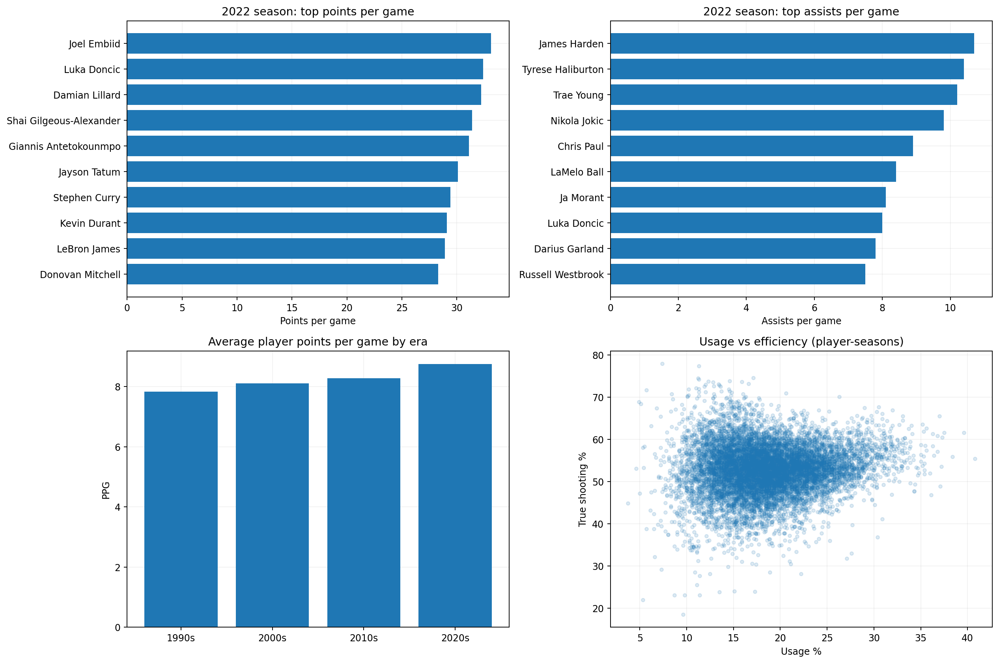

# NBA Player Analytics — Era Intelligence & Data MVP

## Project Overview

This sports analytics project explores NBA player
performance across multiple seasons, comparing:

- Scoring, rebounding, and playmaking
- Usage rate and shooting efficiency
- Statistical improvements across seasons
- Historical eras and player physical characteristics
- Team contributions to elite performance
- Draft-year experience categories
- Exploratory Data MVP rankings

The project was developed using Python and Google Colab.

## Business Objective

Help a sports media company create data-driven
NBA player comparisons, historical insights,
and reproducible MVP discussions.

## Dataset Overview

| Metric | Value |
|---|---|
| Source file | `all_seasons.csv` |
| Original records | 12,844 |
| Analyzed player-season records | 12,836 |
| Excluded repeated-key records | 8 |
| Earliest season start | 1996 |
| Latest season start | 2022 |
| Season leaderboards minimum games | 20 |
| Data MVP minimum games | 40 |

The original dataset was supplied for this exercise.
Its statistics have not been independently reconciled
with official NBA records.

## Data Preparation

The notebook:

1. Loads the original dataset.
2. Inspects missing values and duplicate records.
3. Standardizes statistical columns.
4. Identifies season years and historical eras.
5. Excludes ambiguous repeated player-season keys.
6. Calculates rankings and efficiency measures.
7. Produces CSV exports and visualizations.
8. Validates the main analytical outputs.

## Season Performance Analysis

Players are ranked by:

- Points per game
- Rebounds per game
- Assists per game

Leaderboards apply a minimum-games threshold
to reduce the influence of very small samples.

See `season_top10_leaderboards.csv`.

## Volume Versus Efficiency

The analysis compares:

- Usage percentage
- True shooting percentage

The relationship is descriptive, not causal.

High usage does not necessarily mean low efficiency.

See `usage_vs_efficiency.csv`.

## Most Improved Players

The improvement index combines changes in:

- Points per game
- Rebounds per game
- Assists per game

Only consecutive recorded seasons are compared.

Because the index adds metrics with different units,
it is an exploratory measure rather than an official award.

See `year_over_year_improvement.csv`.

## Era Comparison

The dataset groups seasons into four eras:

- 1990s
- 2000s
- 2010s
- 2020s

### Era Summary

| era | player_seasons | mean_height | mean_weight | mean_ppg | mean_rpg | mean_apg | mean_ts_pct |
| --- | --- | --- | --- | --- | --- | --- | --- |
| 1990s | 1757 | 200.86 | 100.54 | 7.83 | 3.53 | 1.79 | 49.25 |
| 2000s | 4465 | 201.04 | 101.37 | 8.11 | 3.59 | 1.78 | 50.18 |
| 2010s | 4930 | 200.6 | 100.02 | 8.27 | 3.55 | 1.83 | 51.78 |
| 2020s | 1684 | 198.82 | 97.78 | 8.75 | 3.54 | 1.97 | 54.08 |

Height and weight describe recorded player-season
averages. Performance comparisons are not adjusted
for pace, minutes, rule changes, or competition.

## Team Comparison

The team analysis measures how often franchises
appear among top-ranked player-seasons.

Both raw frequencies and rates are useful,
because teams have different coverage periods.

See `team_top_performer_frequency.csv`.

## Rookie Versus Veteran Analysis

Draft year is used to estimate years since draft.

This is not identical to actual NBA experience.

Groups include:

- Draft-year entrants
- Players at least five years after draft
- Other or unknown experience categories

See `draft_year_experience_proxy.csv`.

## Data MVP Methodology

The Data MVP is an exploratory score calculated
from within-season statistical percentile rankings.

| Component | Weight |
|---|---:|
| Points per game | 40% |
| Rebounds per game | 15% |
| Assists per game | 15% |
| True shooting percentage | 30% |
| **Total** | **100%** |

These weights express one transparent editorial
definition of statistical performance.

The model does not directly incorporate:
defensive impact, team success, playoff results,
or the full context used in official MVP voting.

## Selected Season: 2022-23

### Top Data MVP Candidates

| player | season | team | games | points | rebounds | assists | ts_display_pct | data_mvp_score |
| --- | --- | --- | --- | --- | --- | --- | --- | --- |
| Nikola Jokic | 2022-23 | DEN | 69 | 24.5 | 11.8 | 9.8 | 70.1 | 96.81 |
| Joel Embiid | 2022-23 | PHI | 66 | 33.1 | 10.2 | 4.2 | 65.5 | 94.82 |
| Kevin Durant | 2022-23 | PHX | 47 | 29.1 | 6.7 | 5.0 | 67.7 | 94.04 |
| Stephen Curry | 2022-23 | GSW | 56 | 29.4 | 6.1 | 6.3 | 65.6 | 93.77 |
| Damian Lillard | 2022-23 | POR | 58 | 32.2 | 4.8 | 7.3 | 64.5 | 91.79 |
| Domantas Sabonis | 2022-23 | SAC | 79 | 19.1 | 12.3 | 7.3 | 66.8 | 91.42 |
| Luka Doncic | 2022-23 | DAL | 66 | 32.4 | 8.6 | 8.0 | 60.9 | 90.65 |
| Jimmy Butler | 2022-23 | MIA | 64 | 22.9 | 5.9 | 5.3 | 64.7 | 89.18 |
| Giannis Antetokounmpo | 2022-23 | MIL | 63 | 31.1 | 11.8 | 5.7 | 60.5 | 89.07 |
| Shai Gilgeous-Alexander | 2022-23 | OKC | 68 | 31.4 | 4.8 | 5.5 | 62.6 | 88.99 |

See `data_mvp_rankings.csv` for additional rankings.

## Executive Visualization

The project includes:

`nba_executive_dashboard.png`

The dashboard provides a static overview
of the available NBA statistics.

## Data Validation

The analysis checks:

- Required player and season fields
- Ambiguous repeated player-season keys
- Season rankings
- Era coverage
- MVP score ranges
- Available statistical measures

Excluded or ambiguous records are not silently
averaged into fabricated player-season statistics.

See `player_season_duplicate_keys_AUDIT.csv`
when duplicate keys are present.

## Business Recommendations

See [RECOMMENDATIONS.md](RECOMMENDATIONS.md).

The document contains seven evidence-based
editorial and analytics recommendations.

## Main Project Files

| File | Purpose |
|---|---|
| `season_top10_leaderboards.csv` | Seasonal statistical leaders |
| `year_over_year_improvement.csv` | Player improvements |
| `era_comparison.csv` | Historical era statistics |
| `team_top_performer_frequency.csv` | Elite player-season frequency |
| `draft_year_experience_proxy.csv` | Experience-category analysis |
| `usage_vs_efficiency.csv` | Usage and shooting data |
| `data_mvp_rankings.csv` | Exploratory MVP rankings |
| `player_seasons_clean.csv` | Analyzed player-season records |
| `nba_executive_dashboard.png` | Static executive dashboard |
| `RECOMMENDATIONS.md` | Business recommendations |
| `requirements.txt` | Python dependencies |

## Optional Features

**Official MVP comparison:**
Not included because a verified official MVP awards dataset was not supplied.

**PG/SG/SF/PF/C Dream Team:**
Not included because verified player positions were not supplied.

These results must not be invented from incomplete data.

## Tools and Technologies

- Python
- pandas
- NumPy
- Matplotlib
- Google Colab
- CSV

## How to Reproduce

1. Open `NBA_Data_MVP_Analysis.ipynb`
   in Google Colab.
2. Upload the original NBA dataset.
3. If needed, set `DATA_FILE` to the exact file path.
4. Run the notebook cells in order.
5. Review validation results.
6. Find outputs in `/content/NBA_Project6_Outputs`.
7. Download the ZIP package and notebook.

## Limitations

- NBA seasons are only covered where present
  in the supplied dataset.
- Cross-era statistics are not pace-adjusted.
- Position-specific rankings require position data.
- Official MVP comparisons require verified award data.
- Draft-year experience is a proxy.
- Repeated player-season records are excluded
  rather than arbitrarily combined.
- Different MVP weights may change the winner.
- Statistical rankings do not define overall greatness.

## Future Improvements

- Official MVP award comparison
- Verified position-based Dream Team
- More advanced impact metrics
- Pace-adjusted historical comparisons
- Games-played sensitivity analysis
- Team wins and playoff performance

## GitHub Publication

**Repository name:**
`NBA-Player-Era-Data-MVP-Analytics`

**Suggested description:**

NBA player-season analytics exploring era trends,
performance leaders, efficiency, and a transparent
Data MVP model.

Create the GitHub repository:

https://github.com/new

Upload the project files and notebook,
verify the repository, then STOP.
